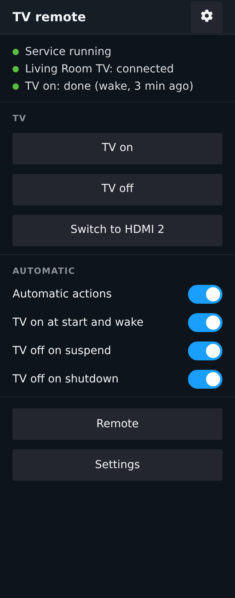
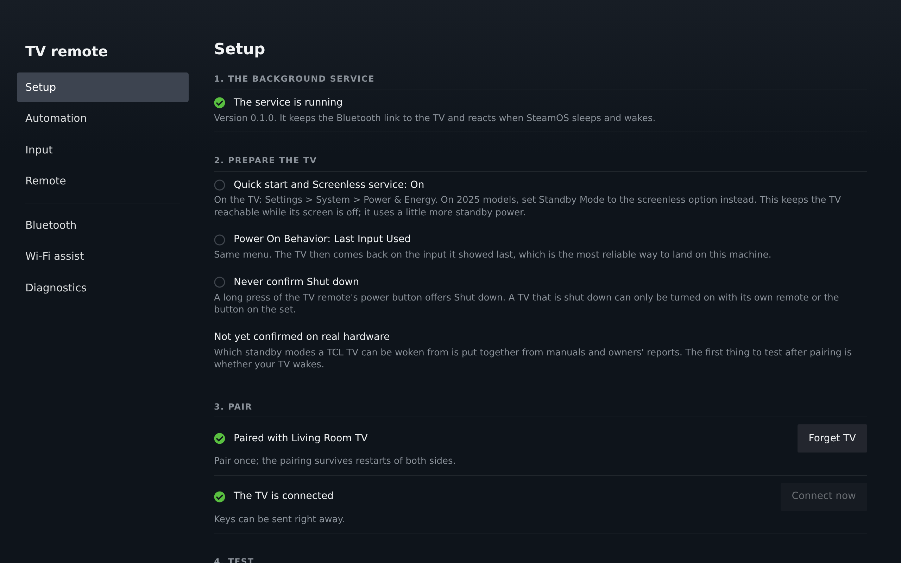

# tcl-me-remo

Let a SteamOS machine control a TCL Google TV over Bluetooth.

The machine pairs with the TV once, as a Bluetooth remote control. From then on:

- when SteamOS **boots or wakes from suspend**, the TV turns on (and can switch to the
  machine's input);
- when SteamOS **suspends or shuts down**, the TV turns off;
- a panel in **Game Mode** (a Decky Loader plugin) configures all of it, and a command line
  tool does the same from a terminal.

<p>
  
  
</p>

*The panel and the settings page, rendered in a browser preview (the plugin has not been run
inside Steam yet).*

> **Not yet confirmed on real hardware.** This was written without access to a TV. The
> design follows Android's and BlueZ's source code and TV owners' reports, and the software
> is tested against simulated system services, but which standby modes a TCL TV can be woken
> from, and a few other things listed in [how it works](docs/how-it-works.md#what-is-not-confirmed),
> still need to be observed. [`docs/hardware-testing.md`](docs/hardware-testing.md) is the
> plan for doing that.

## Is this what you want?

If your machine and TV can talk over **HDMI-CEC**, use that: it wakes the TV and switches
the input in one step, and SteamOS 3.8 and newer support it natively on hardware that has
it (the Steam Machine, or a USB CEC adapter). Most PCs and graphics cards do not pass CEC
through, and docks often do not either. This project is for those: it needs nothing but the
Bluetooth both sides already have.

## What you need

- SteamOS 3.7 or newer (Bazzite and similar systems should work the same way), with Bluetooth
  turned on. The Bluetooth adapter must support the LE peripheral role, which common Intel,
  MediaTek, Realtek and Qualcomm adapters do.
- A TCL Google TV. Other Android / Google TV sets may work; the built-in input-switching
  presets are TCL-specific.
- Optional: [Decky Loader](https://decky.xyz) for the Game Mode panel.

## Install

### With Decky Loader

1. Download `tcl-me-remo.zip` from the [releases page](https://github.com/tiltbob/tcl-me-remo/releases).
   Keep the file name exactly as it is: Decky tells an update from a fresh install by it.
2. In Game Mode open the Decky menu, go to its settings, enable **Developer mode**, then under
   **Developer** choose **Install plugin from ZIP file** and pick the download.

The plugin installs and starts the background service by itself.

If there is no release yet, make the file yourself. It takes only Python, which SteamOS
has (the built panel is part of the repository):

```sh
git clone https://github.com/tiltbob/tcl-me-remo
cd tcl-me-remo
python3 scripts/build_zip.py      # writes out/tcl-me-remo.zip
```

Then pick `out/tcl-me-remo.zip` in Decky's file browser.

The plugin is not in Decky's plugin store, and will not be: the store does not take plugins
written mostly with AI assistance, which this one was.

### Without Decky

In Desktop Mode, open Konsole:

```sh
git clone https://github.com/tiltbob/tcl-me-remo
cd tcl-me-remo
./install.sh
```

`install.sh` needs `sudo`. On SteamOS, set a password for your user first with `passwd`.

Either way the service ends up in `/opt/tcl-me-remo`, its settings in `/var/lib/tcl-me-remo`,
and the `tcl-me-remo` command is linked into `~/.local/bin`. These places survive SteamOS
updates.

## Set up

1. **Prepare the TV** ([details](docs/tv-setup.md)). In Settings > System > Power & Energy
   turn on **Quick start** and **Screenless service** (on 2025 models: the screenless
   *Standby Mode*), and set **Power On Behavior** to **Last Input Used**.
2. **Pair.** Choose *Pair TV* in the panel, or run `tcl-me-remo pair`. Then on the TV open
   Settings > Remotes & Accessories > Pair accessory and pick *SteamOS Remote*.
3. **Try it.** `tcl-me-remo off`, then `tcl-me-remo on`, or the buttons in the panel.

That is all that is needed for power. Suspend the machine and the TV should go off with it.

## Getting to the right input

With *Power On Behavior: Last Input Used* the TV comes back on the input it showed last,
which is usually the SteamOS machine. If you want the machine to switch the input itself,
there are two ways, both off until you turn them on:

- **Key macro over Bluetooth.** Android TVs have no remote key for "HDMI 2", so the machine
  presses the keys you would: open the source list, move to the entry, OK. Pick the HDMI
  port, choose a preset, press *Try* and watch the TV. If the preset misses, adjust the
  macro; `F3 1.5s LEFT*8 RIGHT*2 OK` reads "F3, wait, eight times left, twice right, OK".
  See [macros](docs/macros.md).
- **Wi-Fi assist.** Opt-in. The machine pairs with the TV over the network, the way the
  Google TV phone app does, and asks for the input directly. More reliable than a macro, but
  it needs the TV's network to be up.

## Command line

```
tcl-me-remo status                 what the service is doing
tcl-me-remo on [--no-input]        turn the TV on (and switch input)
tcl-me-remo off                    turn the TV off
tcl-me-remo input                  switch the TV to this machine
tcl-me-remo key HOME               send one key          (tcl-me-remo keys lists them)
tcl-me-remo macro "F3 1.5s LEFT*8 RIGHT*2 OK"
tcl-me-remo pair | forget          pair with the TV / remove the pairing
tcl-me-remo config                 show all settings
tcl-me-remo config input.hdmi_port 2
tcl-me-remo wifi discover | pair <ip> | unpair
tcl-me-remo doctor                 check the set-up; attach this to bug reports
tcl-me-remo logs -n 100
```

## Settings worth knowing

| Setting | Default | Meaning |
|---|---|---|
| `enabled` | on | Master switch for everything automatic |
| `events.boot_tv_on`, `events.resume_tv_on` | on | Turn the TV on at boot / wake |
| `events.suspend_tv_off`, `events.shutdown_tv_off` | on | Turn the TV off at suspend / power-off |
| `events.reboot_tv_off` | off | Also turn it off when the machine merely restarts |
| `display.require_external` | `auto` | On a handheld, act only while an external display is connected |
| `display.edid_match` | empty | Act only while a display with this name is connected (for example `TCL`) |
| `input.method` | `none` | `macro`, `wifi` or `none` |
| `input.hdmi_port` | 1 | The HDMI port the machine is on |
| `bluetooth.reconnect_on_drop` | on | Keep calling the TV while it is not connected |
| `bluetooth.raw_notify` | `auto` | Direct key delivery for TVs that do not re-subscribe after a reboot: `auto` (Linux 6.17 and later only), `on`, `off` |
| `power.on_key`, `power.off_key` | `WAKE`, `SLEEP` | The keys used for power |

All settings, with their limits, are listed by `tcl-me-remo config` and editable in the panel.

## When something does not work

Run `tcl-me-remo doctor`. It checks Bluetooth, the service, the pairing and the suspend
hooks, and says what is wrong in plain words.

- **The TV does not turn on.** Almost always the TV's standby mode: see
  [setting up the TV](docs/tv-setup.md#if-the-tv-does-not-wake).
- **The TV turns on by itself.** Turn off *Keep calling the TV*
  (`bluetooth.reconnect_on_drop`).
- **Keys stopped working after a reboot.** `tcl-me-remo status` shows how keys are being
  delivered, and `tcl-me-remo doctor` says whether direct delivery, the way around a TV that
  does not re-subscribe after a reboot, is in use. On Linux kernels before 6.17 it is not
  used unless you set `bluetooth.raw_notify` to `on`; the error message says so when that is
  the reason. See [after a reboot](docs/how-it-works.md#after-a-reboot); pairing again always
  restores things.
- **The machine does not show up on the TV when pairing.** Pairing mode closes after two
  minutes; open it again. Remove any earlier pairing between the TV and this machine first.
- **A Bluetooth LE controller no longer reconnects.** Set
  `bluetooth.idle_disconnect_seconds` to `30`.

`tcl-me-remo logs` shows what the service did, step by step, for every action.

## Remove

From a terminal, however the service was installed:

```sh
tcl-me-remo uninstall            # stops and removes the service; settings and the pairing stay
tcl-me-remo uninstall --purge    # also deletes the settings and the Bluetooth pairing
```

It asks `sudo` (on SteamOS, set a password first with `passwd`). If the shell does not find
the command, it is `/opt/tcl-me-remo/bin/tcl-me-remo`. `./install.sh uninstall` in a
checkout does the same. With `--purge` the machine forgets the TV; on the TV, remove
*SteamOS Remote* under Remotes & Accessories as well, or the two cannot be paired again.

With Decky, uninstalling the plugin is enough in the usual case. Decky runs the same step
when it only updates a plugin, so the service is not removed at that moment: about three
minutes later it is checked whether the plugin is really gone, and only then is the service
removed (settings and the pairing stay). If the machine is restarted or switched off before
that, the check is made a few minutes after the service next starts. The check removes
nothing when it cannot see Decky's plugins folder. That, and these two cases, are what the
command above is for:

- **Decky Loader itself was removed.** Its uninstaller does not tell the plugins, so the
  service stays, and keeps turning the TV on and off, until you run `tcl-me-remo uninstall`.
- **The plugin is still installed.** It puts the service back whenever it loads, so
  uninstall it in Decky too. To delete the settings and the pairing from the panel instead,
  use *Remove service* with *Also delete settings*, then uninstall the plugin.

## More

- [How it works](docs/how-it-works.md)
- [Setting up the TV](docs/tv-setup.md)
- [Macros and key names](docs/macros.md)
- [Control protocol](docs/control-protocol.md) for scripting
- [Hardware test plan](docs/hardware-testing.md), including how to run a Claude Code session
  on the machine to work through it

## Development

```sh
python3 -m pytest -q --timeout 60     # the service; needs dbus-daemon, no Bluetooth
ruff check .
pnpm install && pnpm run build        # the Decky panel; commit the resulting dist/index.js
pnpm run preview                      # UI checks and screenshots in a browser, no Deck needed
python3 scripts/build_zip.py          # out/tcl-me-remo.zip
```

The service is plain Python 3.11+ with one vendored dependency. Tests run it against fake
BlueZ and logind services on a private D-Bus daemon.

## Licence

MIT. The vendored [dbus-fast](https://github.com/Bluetooth-Devices/dbus-fast) is MIT as well.
